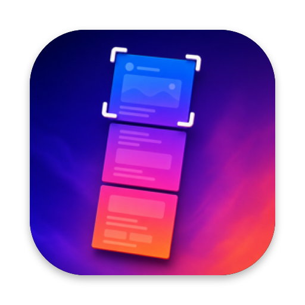

<p>
  
</p>

# Long Screenshot

Scrolling screenshots for macOS.

Set a global shortcut, select a scrollable area in any app, then scroll downward to create one seamless image.

## Features

- **Capture beyond the viewport** — select an area, scroll down slowly, and the frames are stitched into a single PNG.
- **Live preview** while you scroll.
- **Global keyboard shortcut** to start a capture from anywhere.
- **Clothesline** — finished long screenshots hang on a clothesline where you can copy, mark up, show in Finder, or move them to the Trash.
- Available in English, 简体中文, 日本語, and 한국어.

## Requirements

- macOS 26.0+
- Screen Recording permission (macOS asks the first time you capture)

## Install

```bash
brew install --cask yusuke-114/tap/longscreenshot
```

To upgrade to the latest version:

```bash
brew upgrade --cask longscreenshot
```

To uninstall (use this instead of dragging the app to the Trash):

```bash
brew uninstall --cask longscreenshot
```

Or download the ZIP from [Releases](../../releases).

### Install fails with `It seems there is already an App at '/Applications/LongScreenshot.app'`

Another copy (for example the Mac App Store version) is already installed. Remove it first, or let Homebrew replace it:

```bash
brew install --cask --force yusuke-114/tap/longscreenshot
```

### Install fails with `App source '/Applications/LongScreenshot.app' is not there`

Long Screenshot was removed by dragging it to the Trash, so Homebrew still thinks it is installed. Run this to reinstall:

```bash
brew uninstall --cask --force longscreenshot && brew install --cask yusuke-114/tap/longscreenshot
```

## Quick Start

1. Open Long Screenshot and choose a save folder.
2. Record a keyboard shortcut.
3. Press the shortcut, select the area to capture, and press **Start**.
4. Scroll down slowly, keeping each new frame overlapping the previous one, then press **Done**.

## Links

- [Privacy Policy](https://yusuke-114.github.io/LongScreenshotApp/)
- [License](LICENSE)

The clothesline is adapted from [Tendedero](https://github.com/alejandrobujan/tendedero) by Alejandro Buján, used under the MIT License.
